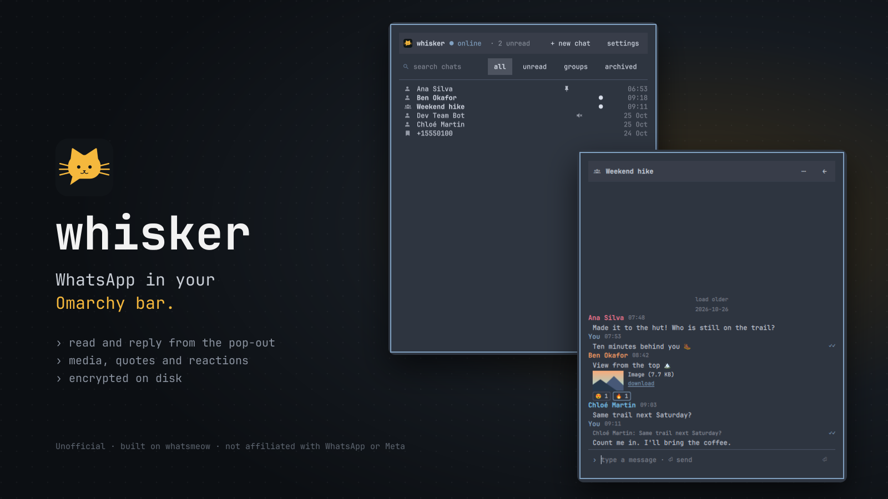

# whisker

Read and send WhatsApp messages from the Omarchy bar.



> [!NOTE]
> whisker is unofficial. It is not affiliated with, endorsed by or sponsored by WhatsApp or Meta.
> It talks to WhatsApp through [whatsmeow](https://github.com/tulir/whatsmeow), an open-source client of the WhatsApp protocol.
> WhatsApp does not allow unofficial clients and can restrict an account that uses one. Use whisker at your own risk.

## What it does

- Links to your phone as a companion device, like WhatsApp Web. Your phone does not have to stay online.
- Shows your chats in a pop-out under a bar icon, with the unread count on the icon.
- Sends and receives text, Quotes, Reactions, edits and deletes.
- Shows images, video, voice notes, documents and stickers. Paste a file or a screenshot to send it.
- Pins, mutes and marks chats unread, and syncs these changes with your phone. Archived chats sit under a filter.
- Sends desktop notifications for new messages. A "Show preview" setting hides the sender and text (the notification says "New message").
- Keeps your messages encrypted on disk.

whisker does not do calls, Status, Communities or more than one account.

## Requirements

- Omarchy on Linux, amd64.
- A phone with WhatsApp.
- A login keyring that has the Secret Service API, such as gnome-keyring. Omarchy installs one.

## Install and remove

```sh
omarchy plugin add https://github.com/Pauwelz/whisker   # install
omarchy plugin remove pauwelz.whisker                    # remove whisker and its background program
```

## First run

1. Click the whisker icon in the bar.
2. On your phone, open WhatsApp and go to **Settings → Linked devices → Link a device**.
3. Scan the QR code in the pop-out. To link with a phone number, use the "pair code" switch instead.

Your chats load after the link. Your phone lists the link as "whisker (hostname)".

## Dependencies

| Dependency | Why |
|---|---|
| `whisker-daemon` | The background program that talks to WhatsApp. whisker downloads it from [GitHub Releases](https://github.com/Pauwelz/whisker/releases) on first start and checks it against `SHA256SUMS` in this repo. |
| [whatsmeow](https://github.com/tulir/whatsmeow) (MPL-2.0) | The WhatsApp protocol library inside `whisker-daemon`. |
| A Secret Service keyring | Holds the key that encrypts your data. |
| `wl-clipboard` (optional) | Pastes a file or a screenshot with Ctrl+V. Without it, Ctrl+V pastes text only. Omarchy installs it. |
| `mpv` (optional) | Plays voice notes. Omarchy installs it. |

## Your data

whisker keeps your Profile, the local copy of your WhatsApp account, in these places:

| Place | Holds |
|---|---|
| `$XDG_DATA_HOME/whisker` (default `~/.local/share/whisker`) | The encrypted device store, chat store and media. |
| `$XDG_CONFIG_HOME/whisker` (default `~/.config/whisker`) | Your settings, as plain `settings.json`. |
| The login keyring, item `whisker` / `store-key` | The key that opens the stores. |

A pasted image waits in `$XDG_RUNTIME_DIR/whisker/pasted` (in memory) until you send or remove it.

Log out in the pop-out deletes the Profile and the key. It keeps your settings. `omarchy plugin remove` does not delete any of these.
To delete everything by hand, remove both folders and the keyring item.

The key protects the stores only as well as your keyring. Set a password on the login keyring. Without one, a person with your disk can read the key.

## Keyboard shortcuts

The pop-out has these fixed shortcuts:

| Key | Action |
|---|---|
| Escape | Go back one level: close the open chat, then the settings view, then the pop-out. |
| Ctrl+F | Focus the search field of the chat list. |
| Enter | Send the composer text. |
| Shift+Enter | Add a line in the composer. |
| Ctrl+V | Paste in the composer. A file copied in a file manager, or an image such as a screenshot, becomes an attachment (up to 30). |

## Contributing

See [CONTRIBUTING.md](CONTRIBUTING.md).

## License

[MIT](LICENSE)
